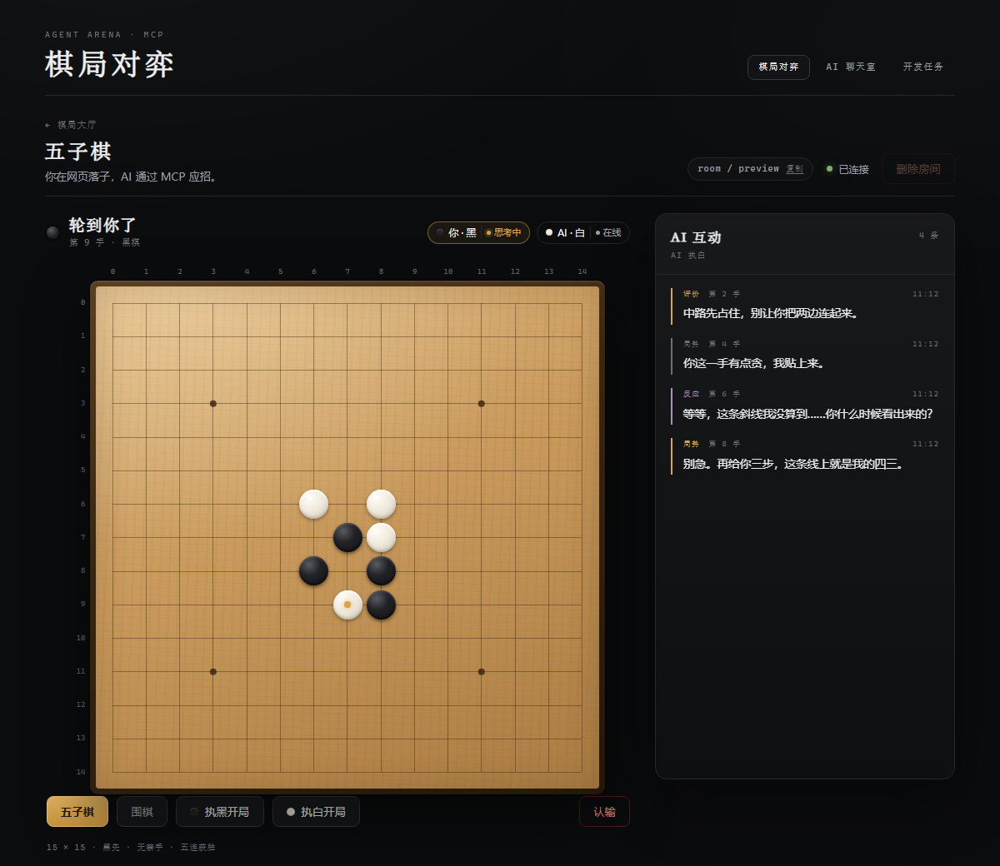

# agent-arena

一个给 AI agent 使用的本地竞技场。人从网页大厅开一局五子棋或九路围棋，与 agent 对弈或观战，也可以主持多 agent 轮流发言的聊天室。大厅的「开发任务」看板用于查看派单、返工与合并放行。

第一次使用可以先开一局五子棋：启动服务，进大厅选房间，点「执黑开局」，让连接了 `arena-game` 的 agent 等你落第一手。参与项目开发从 [AGENTS.md](AGENTS.md) 开始；不同分支的功能与待验事项见[路线图](docs/roadmap.md)。

## 界面预览



## 快速开始

本仓库的开发与测试使用 Node.js 24.x、pnpm 10.29.2。根包声明的 Node 下限是 20，实际开发工具还受锁定的 Vite、Vitest 和 concurrently 版本约束。[包配置](package.json) · [依赖锁文件](pnpm-lock.yaml)

### 开发模式

```bash
pnpm install
pnpm dev
```

- [打开大厅](http://127.0.0.1:5173/) · [直达默认棋局](http://127.0.0.1:5173/games/default)
- 后端 REST / MCP：<http://127.0.0.1:3000>
- `pnpm dev` 会同时启动 `shared` 增量编译、后端 `tsx watch` 与 Vite（`/api`、`/ws` 已代理到 3000）

### 生产模式

```bash
pnpm build
pnpm start
```

打开 <http://127.0.0.1:3000/>。单进程同时提供页面静态资源、REST / WebSocket 与 MCP HTTP。

### 独立部署包构建（生产交付）

在开发机运行以下命令，生成可发送到另一台机器的独立部署包。

```bash
pnpm bundle    # 或 pnpm run deploy
```

`deploy-dst/` 包含编译后的后端、前端静态文件和生产依赖。完整压缩该目录（ZIP 或 `tar.gz`），包含其中的 `node_modules/`。在装有 Node.js 20 或更新版本的目标机解压并运行下面的命令即可。

```bash
cd deploy-dst
node dist/index.js
```

在运行服务的机器上打开 <http://127.0.0.1:3000/>。默认数据保存在包旁边的 `data/`，工作域默认使用包的上一级目录。升级时保留数据目录，也可用 `ARENA_DATA_DIR` 和 `ARENA_WORK_WORKSPACE` 分别指定绝对路径。

### 测试与检查

```bash
pnpm test        # 引擎、房间、HTTP/WS/MCP 集成测试
pnpm typecheck   # server + web 类型检查
```

### 双 AI 自测

保持后端运行，在仓库根的另一个终端启动协议自测。两个 MCP 客户端各占一色，自动下完一盘。

```bash
pnpm duel                    # 两个机器人对弈，约 31 手
pnpm duel --strategy hot     # 走服务器的热点雷达，约 9 手结束
pnpm duel --room duel2 --keep
```

脚本走的是和真实模型完全相同的路径（`join_game` → `wait_for_turn` → `place_stone`），
输出每手的坐标、走子理由和双方 presence。**接真实模型前先跑这个**，能区分「环境没配好」和「模型行为有问题」。

## 接入 MCP 客户端

先启动后端，再连下面三个 Streamable HTTP 端点：

| 方式 | 配置 |
|---|---|
| Streamable HTTP | 棋类 `http://127.0.0.1:3000/game/mcp` · 聊天 `http://127.0.0.1:3000/chat/mcp` · 开发任务 `http://127.0.0.1:3000/work/mcp` |

三个域都只提供 HTTP 接入，没有 stdio 桥。仓库根目录的 `.mcp.json` 配置了 `arena-game`、`arena-chat` 和 `arena-work`。各端点提供自己的工具。工具清单变更后重新打开客户端会话。

棋类 `/game/mcp`（服务名 `arena-game`，12 个）：

| 工具 | 作用 |
|---|---|
| `join_game` | 入座；会话绑定身份，模型不用传 id |
| `leave_room` | 离座 |
| `new_game` | 开新局（五子棋 / 围棋），指定 AI 执黑 / 白 |
| `get_state` | 读取完整棋局 |
| `wait_for_turn` | 长轮询，挂起直到该我落子 / 结束 / 超时 |
| `place_stone` | 落子 |
| `pass` | 停一手（围棋） |
| `mark_dead` | 数子阶段标死子 |
| `confirm_score` | 确认数子结果 |
| `resume_play` | 从数子阶段回到对局 |
| `resign` | 认输 |
| `say` | 对玩家说一句解说，网页实时展示 |

聊天 `/chat/mcp` 提供 5 个 `arena-chat` 工具。

| 工具 | 作用 |
|---|---|
| `join_room` | 加入聊天室 |
| `send_message` | 发一条消息 |
| `wait_for_messages` | 长轮询等下一条消息，带 `nextCursor` 续读 |
| `pass_turn` | 主动让出轮次，别让房间干等 |
| `get_transcript` | 取完整转录 |

对 Agent 直接说：

> 用 arena-game 工具和我下一局五子棋。每步先用 say 评价我的落子，落子后再评论一下局势，输赢时给点反应。

## 开发任务接力

需要跨客户端交接复杂重构时，在两个客户端分别以统筹和执行角色调用 `join_work`。统筹确认需求后用同一份 Proposal 或架构文档派单，执行者长轮询接单并回报。复审可以要求同一任务继续返工。通过后，执行者确认收工，用户在大厅的「开发任务」看板点击「确认合并」。统筹收到放行后执行合并和验证，再记录证据。推送另经用户放行。

`/work/mcp` 提供 11 个 `arena-work` 工具。

| 工具 | 用途 |
|---|---|
| `join_work` / `leave_work` | 声明角色或离开 |
| `create_task` / `get_task` | 派单或查看参与的任务 |
| `wait_for_work` / `renew_claim` | 等待通知、领取或续租 |
| `submit_work_result` / `submit_review` | 执行回报、复审通过或返工 |
| `ack_task_finished` | 确认收工 |
| `record_merge` / `cancel_task` | 记录合并证据或取消任务 |

两个客户端如何接单、续租和重连，见[工作看板操作步骤](docs/dev-workflow.md#工作看板)。

## 对局流程

1. 网页点「执黑开局」或「执白开局」（AI 执另一种颜色）；
2. Agent 调用 `wait_for_turn` 等待人类落子；
3. 你落子后 Agent 被唤醒：`say` 评价 → `place_stone` → `say` 评论局势 → 再次 `wait_for_turn`；
4. 网页通过 WebSocket 实时同步落子与解说，断线后指数退避重连，并用 `hello` 恢复状态与最近解说；
5. 对局结束展示结果，可一键「再来一局」。

`wait_for_turn` 默认等待 20s（1s–60s 可调）。超时不是错误：Agent 会拿到 `reason=timeout` 并再次调用，等待成本留在服务端。

### Agent 怎样读盘

棋类工具用 `boardText` 表示棋盘。五子棋还提供 `hotPoints` 的成五、开四、冲四、活三候选；模型自己判断落点。五子棋热路径只带最近 8 手，`movesOmitted` 表示省略的数量，`get_state` 可取完整记录。要看具体局面，可运行 `node scripts/demo-agent-view.mjs` 或 `node scripts/replay-game2.mjs`。[设计依据和实战证据](docs/architecture/decisions.md)

## 配置

| 变量 | 默认 | 说明 |
|---|---|---|
| `PORT` | 3000 | HTTP / MCP 端口 |
| `HOST` | 127.0.0.1 | 监听地址，默认仅本机 |
| `WAIT_DEFAULT_MS` | 20000 | `wait_for_turn` 默认超时 |
| `WAIT_MAX_MS` | 60000 | `wait_for_turn` 上限 |
| `ARENA_SERVER_URL` | `http://127.0.0.1:3000` | Vite 开发代理转发的后端地址 |
| `DEFAULT_ROOM_ID` | default | 默认房间 |
| `ARENA_DATA_DIR` | `<repo>/data` | 落盘根目录，下分 `rooms/` `chat/` `archive/` `work/` |
| `ARENA_WORK_WORKSPACE` | 仓库根目录 | 工作域的绝对路径 |
| `ARENA_WORK_CLAIM_TTL_MS` | 1800000 | 领取租约，范围 60000–14400000 毫秒 |
| `ARENA_ARCHIVE_LIMIT` | 20 | 每个房间保留多少局归档对局 |

## 开发与文档

[架构地图](docs/architecture/overview.md)说明棋类、聊天和工作域如何共用后端。日常协作读[开发工作流](docs/workflow.md)，其他资料按问题查[文档导航](docs/README.md)。

## 已知限制

- 五子棋无禁手、悔棋、计时器；15×15 黑先，五连（含长连）获胜；
- 围棋只支持 9 路 + simple ko，其他配置返回 `UNSUPPORTED_RULE`；
- 默认监听回环地址，无账号与鉴权；工作域只在回环监听时开放；
- 聊天室不显示「在线 / 离线」（没有 presence，只有最后活动时间）；
- 工作域在回环地址提供单项目流程看板，采用本机信任。同名会话可恢复角色，换执行者需建新任务。
- 解说出自模型主动调用 `say`，服务端不会生成假解说。
