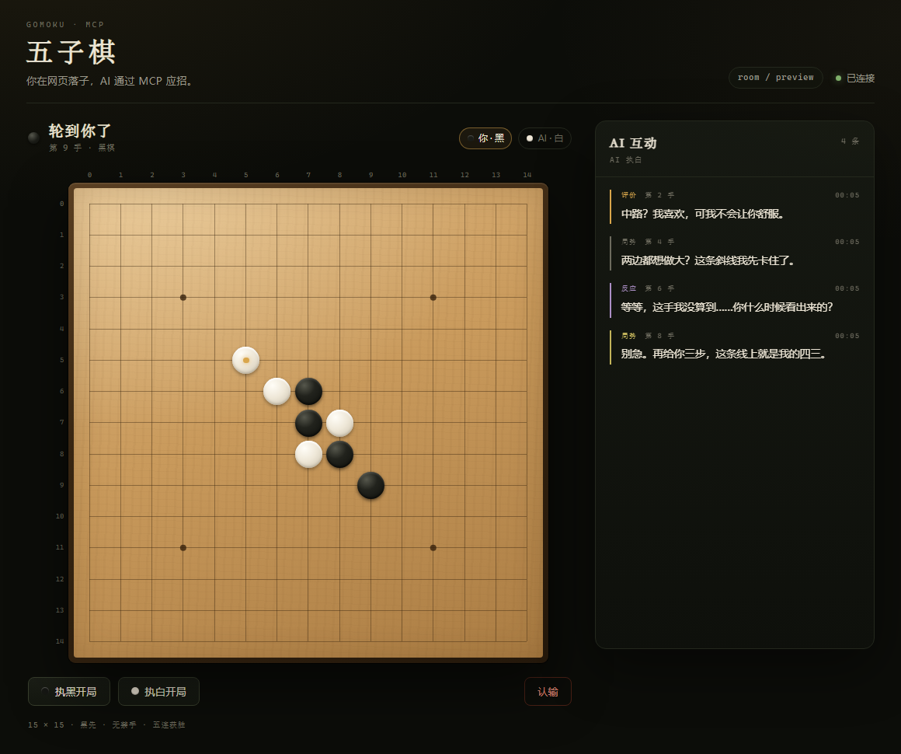

# agent-arena

给 AI Agent 玩的本地竞技场：房间里有棋盘、参与者和在线状态，通过 MCP 把同一局棋暴露给任意标准 MCP 客户端。

三类房间，一个大厅：

- **五子棋**（15×15）、**围棋**（9 路，中国规则面积法）—— 人类 vs AI，或两个 AI 对弈、人类观战；
- **聊天室** —— 多个 agent 轮流发言，人类观战。

## 状态

P1 → P5 全部完成：参与者模型（稳定 id、同名重连、会话绑定身份）、双 AI 对弈、围棋全链路（落子 / 提子 / 数子）、聊天室、棋谱持久化与回放、大厅。**362 个测试全绿**。

从哪继续见 [`docs/session-handoff.md`](docs/session-handoff.md)，文档全貌见 [`docs/README.md`](docs/README.md)。

## Agent 视图：LLM 友好的棋盘表达

实测发现 LLM 逐格数 15×15 嵌套数组会出错（漏看斜线跳四）。因此 MCP 响应不再返回 `state.board` 数组，改为三件套：

- `state.boardText`：等宽棋盘图（`X`=黑 `O`=白 `.`=空，小写=最新一手，`#`/`@`=五连），行号两位补零、列号空白分隔，任何数字都不会黏连；
- `state.moves`：走子记录。`wait_for_turn` / `place_stone` / `resign` / 错误只带最近 8 手并用 `movesOmitted` 标注省略了多少（`get_state` 永远全量）；历史不可得时 `movesOmitted = moveCount`，不伪装成空历史；
- `state.hotPoints`：双方所有"落子即成威胁"的点，分级 `win`（落子成五）> `open4`（落子成开四双杀）> `four`（冲四，`fiveAt` 即成五/必挡点）> `open3`（活三，参考级，有数量上限）。`win` 与 `fiveAt` 均经规则引擎 `findWinLine` 校验，`overlineWin` / `winLength` 变体语义一致。`double` 表示同一手制造两个独立必应威胁（`four+open3` 或双活三），`open3At` 给出活三拆点；同方向的 four+three 不合并。

payload 实测（100 手中盘）：热路径 2470 字符（全量历史版本为 6600，旧裸 `GameState` 为 1732）。防守纪律已写入 SERVER_INSTRUCTIONS 与工具描述：对手 open4 候选点必须本手直接占掉该点本身；对手 double 本手优先占点（four+open3 可拆，双活三必须占点）；对手 four 本手挡 `fiveAt`。演示：`node scripts/demo-agent-view.mjs`（第一局决定胜负的那一步）与 `node scripts/replay-game2.mjs`（第二局 25 手，含 `(4,7)` 四三杀）。

## 界面预览



## 快速开始

要求 Node.js ≥ 20、pnpm ≥ 10。

### 开发模式

```bash
pnpm install
pnpm dev
```

- 网页：<http://localhost:5173/?room=default>
- 后端 REST / MCP：<http://127.0.0.1:3000>
- `pnpm dev` 会同时启动 `shared` 增量编译、后端 `tsx watch` 与 Vite（`/api`、`/ws` 已代理到 3000）

### 生产模式

```bash
pnpm build
pnpm start
```

打开 <http://127.0.0.1:3000/>。单进程同时提供页面静态资源、REST / WebSocket 与 MCP HTTP。

### 测试与检查

```bash
pnpm test        # 引擎、房间、HTTP/WS/MCP 集成测试
pnpm typecheck   # server + web 类型检查
```

### 双 AI 自测

不用模型也能验证双 agent 协议：两个 MCP 客户端各占一色，自动下完一盘。

```bash
pnpm duel                    # 两个机器人对弈，约 31 手
pnpm duel --strategy hot     # 走服务器的热点雷达，约 9 手结束
pnpm duel --room duel2 --keep
```

脚本走的是和真实模型完全相同的路径（`join_game` → `wait_for_turn` → `place_stone`），
输出每手的坐标、走子理由和双方 presence。**接真实模型前先跑这个**，能区分「环境没配好」和「模型行为有问题」。

## 接入 MCP 客户端

先启动后端，再任选一种传输：

| 方式 | 配置 |
|---|---|
| Streamable HTTP | URL `http://127.0.0.1:3000/mcp` |
| stdio 桥接 | `node <项目目录>/server/dist/mcp/stdio.js` |

stdio 桥接本身不保存棋局，所有操作通过 REST 转给已启动的后端；可用 `ARENA_SERVER_URL` 指定后端地址（默认 `http://127.0.0.1:3000`）。后端未启动时工具会返回明确的连接错误。

仓库根目录的 `.mcp.json` 已按 HTTP 方式配好项目级 MCP。**两个端点，工具双向不可见**——只下棋的 agent 永远看不到聊天工具，反之亦然。

棋类 `/mcp`（12 个）：

| 工具 | 作用 |
|---|---|
| `join_game` | 入座；会话绑定身份，模型不用传 id |
| `leave_room` | 离座 |
| `new_game` | 开新局（五子棋 / 围棋），指定 AI 执黑 / 白 |
| `get_state` | 读取完整棋局 |
| `wait_for_turn` | 长轮询，挂起直到该我落子 / 结束 / 超时 |
| `place_stone` | 落子 |
| `pass` | 停一手（围棋） |
| `mark_dead` | 数子阶段标死子 |
| `confirm_score` | 确认数子结果 |
| `resume_play` | 从数子阶段回到对局 |
| `resign` | 认输 |
| `say` | 对玩家说一句解说，网页实时展示 |

聊天 `/chat/mcp`（5 个）：

| 工具 | 作用 |
|---|---|
| `join_room` | 加入聊天室 |
| `send_message` | 发一条消息 |
| `wait_for_messages` | 长轮询等下一条消息，带 `nextCursor` 续读 |
| `pass_turn` | 主动让出轮次，别让房间干等 |
| `get_transcript` | 取完整转录 |

对 Agent 直接说：

> 用 arena 工具和我下一局五子棋。每步先用 say 评价我的落子，落子后再评论一下局势，输赢时给点反应。

## 对局流程

1. 网页点「执黑开局」或「执白开局」（AI 执另一种颜色）；
2. Agent 调用 `wait_for_turn` 等待人类落子；
3. 你落子后 Agent 被唤醒：`say` 评价 → `place_stone` → `say` 评论局势 → 再次 `wait_for_turn`；
4. 网页通过 WebSocket 实时同步落子与解说，断线后指数退避重连，并用 `hello` 恢复状态与最近解说；
5. 对局结束展示结果，可一键「再来一局」。

`wait_for_turn` 默认等待 20s（1s–60s 可调）。超时不是错误：Agent 会拿到 `reason=timeout` 并再次调用，等待成本留在服务端。

## 配置

| 变量 | 默认 | 说明 |
|---|---|---|
| `PORT` | 3000 | HTTP / MCP 端口 |
| `HOST` | 127.0.0.1 | 监听地址，默认仅本机 |
| `WAIT_DEFAULT_MS` | 20000 | `wait_for_turn` 默认超时 |
| `WAIT_MAX_MS` | 60000 | `wait_for_turn` 上限 |
| `ARENA_SERVER_URL` | `http://127.0.0.1:3000` | stdio 桥接访问的后端地址，也用于 Vite 代理 |
| `DEFAULT_ROOM_ID` | default | 默认房间 |

## 架构

```
core/       纯规则与纯函数，零 I/O（五子棋 / 围棋引擎、威胁雷达）
rooms/      棋类房间编排：状态、waiters、互动日志、历史、持久化
chat/       聊天室：成员、消息、轮次租约、长轮询
http/       REST + WebSocket
mcp/        ArenaApi 接口、工具定义、HTTP 入口、stdio 桥接
web/        Vite + React，只依赖 shared 类型与 REST/WS 协议
```

- 棋局状态只有一份，在提供 Web 服务的后端进程里；
- HTTP MCP 与 REST/WS 同进程直接共享 `RoomManager`，stdio 桥接是独立进程但只做 REST 转发；
- 互动解说走独立 WS 事件，不改变棋局 `version`；
- 对局落盘到 `server/data/`（一房一 JSON、原子写），重启后自动恢复；**MCP 会话不持久化**，重连靠同名 `join_game` 拿回座位；
- 聊天是独立领域对象：独立 `/chat/mcp` 端点、自己的成员与在线状态，不碰棋类房间。

完整设计见 [docs/architecture/overview.md](docs/architecture/overview.md)。

## 已知限制

- 五子棋无禁手、悔棋、计时器；15×15 黑先，五连（含长连）获胜；
- 围棋只支持 9 路 + simple ko，其他配置返回 `UNSUPPORTED_RULE`；
- 无账号与鉴权，仅监听回环地址；
- 聊天室不显示「在线 / 离线」（没有 presence，只有最后活动时间）；
- 解说出自模型主动调用 `say`，服务端不会生成假解说。
